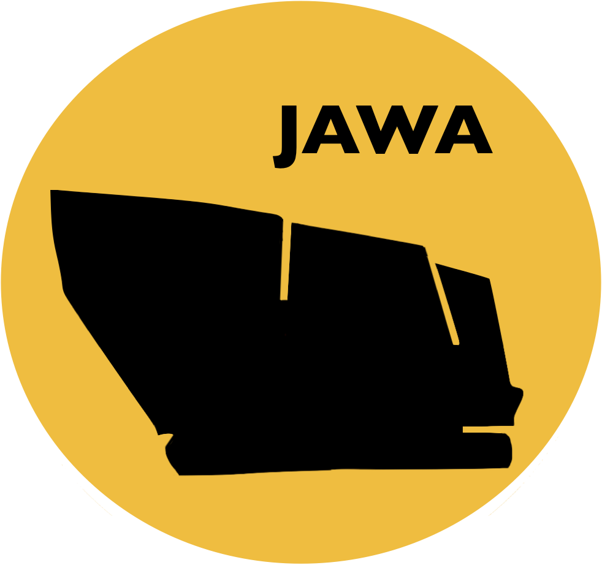

# Jamf Automation and Webhook Assistant ("JAWA") Version 3.2

<p align="center">  </p>


JAWA allows an IT Administrator to focus on providing the best end user experience through automation.

> **Prefer a hosted option?** JAWA is self-hosted — you run and maintain the server yourself. If you'd rather not operate infrastructure, **[Jamf Routines](https://learn.jamf.com/r/en-US/prerelease-routines-beta/Routines)** is a Jamf-hosted, Jamf-supported automation service. You can run both — see [JAWA vs. Jamf Routines](#jawa-vs-jamf-routines) below.

***[!]** NOTE: Always test automations in a dev/eval environment before deploying to production.*

## What is JAWA?

JAWA, the Jamf Automation and Webhook Assistant, is a web server designed to streamline automation workflows with Jamf Pro and other services. It features a webhook receiver for real-time automation and a crontab for scheduled script execution and report generation. JAWA simplifies the creation of time-saving workflows for Jamf Pro admins, providing a user-friendly framework to connect multiple services seamlessly within an organization.


*Check out [JAWA on the Jamf Marketplace](https://marketplace.jamf.com/details/jawa/) for screenshots.*

*Read the [JAWA Admin Guide](https://github.com/jamf/JAWA/wiki) too!*

## JAWA vs. Jamf Routines

JAWA and [Jamf Routines](https://learn.jamf.com/r/en-US/prerelease-routines-beta/Routines) both automate Jamf Pro workflows, in different ways.

| | **JAWA** | **Jamf Routines** |
|---|---|---|
| **Hosting** | Self-hosted (your server) | Jamf-hosted |
| **Maintenance** | You own the OS, TLS, updates, and uptime | Managed by Jamf |
| **Support** | Community / open source | Jamf-supported |
| **Automation model** | Your own scripts, triggered by webhooks or a schedule | Template-based workflows that connect tools to Jamf Pro |
| **Setup effort** | Provision a server, certificate, and DNS | Sign in and go |

**Choose JAWA** if you want full control, custom scripting, and don't mind running a server. **Choose Jamf Routines** if you'd rather not manage infrastructure and want a Jamf-supported, hosted experience. You can run both — they complement each other. For Jamf Routines availability and pricing, see the [Jamf Routines documentation](https://learn.jamf.com/r/en-US/prerelease-routines-beta/Routines).

## Server Requirements

### General Server Requirements:

- Ubuntu 24.04+ or RHEL / Rocky 9.4+
- Minimum: 8GB RAM (16GB recommended)
  - On RHEL 9, do not go below 2GB even for a trial: `dnf` is memory-hungry enough that package
    installs get OOM-killed on a 1GB instance. Ubuntu completes on 1GB.
- Minimum: 128GB Storage (512GB recommended)
- Minimum: 2 CPU Core (4 Cores recommended)
- Python 3.12+ (with pip)

> The installer builds JAWA's virtual environment from the distribution's Python 3.12, so the OS
> version is what determines the Python version. Ubuntu 24.04+ ships `python3` = 3.12. On
> RHEL/Rocky 9.4+ the default `python3` is still 3.9, so the installer installs the supported
> `python3.12` AppStream package and builds the venv with it — this needs no manual steps.
> Ubuntu 22.04 (Python 3.10) and RHEL/Rocky 9.0–9.3 are below the floor and not supported:
> JAWA's dependencies publish security fixes only for Python 3.10+, and Python 3.9 and 3.10
> themselves no longer receive upstream security updates (EOL 2025-10-31 and 2026-10-01).
>
> **Upgrading the OS of an existing JAWA server.** If your JAWA host is below Ubuntu 24.04,
> reaching a supported platform means an in-place distribution upgrade (`do-release-upgrade`).
> That upgrade can leave nginx no longer serving JAWA — the console becomes unreachable even
> though the `jawa` service is running. **Re-run the JAWA installer after the distribution
> upgrade completes** and choose the upgrade option; it rewrites and re-enables JAWA's nginx
> site, which restores the console. Take a snapshot of the server before starting, as with any
> distribution upgrade.
>
> The installer checks the Python version **before it touches an existing install** and stops
> with the detected version if the host is below Python 3.12.

### Sign-in and the Jamf Pro URL

The installer asks for your Jamf Pro URL and saves it in `data/server.json`. Until a URL is saved
there, the console refuses every sign-in with "Finish install: set the Jamf Pro URL with the
installer". For local development only, set `JAWA_ALLOW_UNPINNED_LOGIN=1` to allow a sign-in
before a URL is saved.

JAWA signs session cookies with the key in `JAWA_SECRET_KEY` when that variable is set. Otherwise
it creates `data/.secret_key` (mode 0600) on first start and reuses it, so a restart does not sign
admins out. The session keeps only the Jamf Pro bearer token, never the password.

Any Jamf Pro account that can sign in can use the console, and the console can upload and run
scripts on the JAWA server. To limit that, list the permitted Jamf Pro usernames under "Allowed
admin accounts" on the Setup page (or as `allowed_admins` in `data/server.json`). Names are
compared case-insensitively. While the list is empty, which is the default so existing installs
keep working, every account that Jamf Pro accepts can sign in, and the Setup page shows a warning.

Each failed console sign-in writes a `LOGIN FAILED user=<name> ip=<address>` line to
`data/jawa-auth.log`, using the `X-Real-IP` header that the installer's nginx configuration sets.
The installer adds a fail2ban filter and jail for that file (five failures in ten minutes ban the
address for thirty minutes on port 443). On servers installed earlier, copy the same two files
(`/etc/fail2ban/filter.d/jawa.conf` and `/etc/fail2ban/jail.d/jawa.conf`) by hand or rerun the
installer.

### Network Requirements:

- Inbound port 443 from JPS for
  webhooks ([IPs for Jamf Cloud](https://docs.jamf.com/technical-articles/Permitting_InboundOutbound_Traffic_with_Jamf_Cloud.html))
- Optional: Inbound port 443 from your LAN/IP (for web console access)
- Outbound port 443 to JPS and auxiliary services (
  Okta, WorkDay, etc.)
- A public DNS entry for the JAWA FQDN

### Health check

`GET /healthz` needs no sign-in and writes nothing to disk or the log, so any uptime monitor can
poll it. It returns `200` with `{"status": "ok"}` when `data/webhooks.json` and `data/cron.json`
parse and the `scripts` directory exists. Otherwise it returns `503` and names the failing check,
for example `{"status": "fail", "check": "webhooks.json"}`.

### Certificate Requirements:

- Jamf Pro connects to JAWA over HTTPS to send webhooks.  JAWA must present a valid certificate for Jamf Pro to trust the connection. 
- A Publicly Trusted SSL Certificate and corresponding private key (for nginx)
   - Note: A _Publicly Trusted Full-chain Certificate_ is preferred
  for `jawa.crt`(i.e., root CA + intermediate + leaf cert bundle) 


### Jamf Pro Requirements:
- Jamf Pro Server 10.35.0+ 

## How to Use JAWA

Refer to the "JAWA Administrators Guide" in the [current release](https://github.com/jamf/JAWA/releases) for detailed installation and configuration instructions.

### Installation Steps:

1. Verify that you meet the server requirements.
2. Rename the certificate to `jawa.crt` and the private key to `jawa.key`.
3. Ensure you are in the same directory as your `jawa.crt` and `jawa.key`.
4. Download and run the JAWA installer:

      ```bash
      curl -O https://raw.githubusercontent.com/jamf/JAWA/main/bin/installer.sh && sudo bash ./installer.sh
      ```

   The installer clones `main` from jamf/JAWA by default. To install from another repository or
   branch, add `repo <git url>` and `branch <name>` (for example
   `repo https://github.com/<you>/JAWA.git branch develop`).

5. After the installation is complete, go to your FQDN (e.g., https://jawa.company.com) in your web browser to continue with the web-based setup.

JAWA listens on `127.0.0.1:8000` behind the nginx proxy. Set the `JAWA_BIND` environment variable (for example `JAWA_BIND=0.0.0.0`) only for setups without nginx.

### Configuration Steps:

1. Log in to JAWA with your Jamf Pro URL and Jamf Pro Administrator Credentials.
2. Click the “Setup link in the JAWA Dashboard or click Setup in the top navigation.
3. Fill out the Server Setup form:
    - [required] JAWA Server Address FQDN (e.g., https://jawa.company.com) - this address must be resolvable by the Jamf Pro Server to send webhooks.
    - [recommended] Lock your JAWA to a primary Jamf Pro Server.
    - [optional] Add an alternate Jamf Pro Server.
4. Click Setup.
5. Set up your first webhook or timed automation.


When scripting for webhooks, verify JSON structure sent from source:

1. [Jamf Pro Webhook Event Info](https://developer.jamf.com/developer-guide/docs/webhooks)
2. [Okta Webhook Event Info](https://developer.okta.com/docs/reference/api/event-types/?q=event-hook-eligible)

## Writing Automation Scripts

JAWA runs **your** scripts in response to Jamf Pro (or Okta/custom) webhooks and on a schedule. A script can be written in any language JAWA's host can execute; the examples here are Python. This section describes the contract JAWA uses to call your script.

### How JAWA calls a webhook script

When a webhook fires, JAWA executes your script and passes the **entire event payload as a single JSON string in the first command-line argument** (`sys.argv[1]`). It does not use stdin, environment variables, or a file. Your script's first job is to parse it:

```python
import json
import sys

event_data = json.loads(sys.argv[1])   # the whole webhook payload
```

A Jamf Pro webhook payload has two top-level keys:

- `event_data["webhook"]` — event metadata (`webhookEvent`, `eventTimestamp`, `id`)
- `event_data["event"]` — the event's own fields (for example `groupAddedDevicesIds`, `name`)

### Output and status (webhook automations)

- Anything your script prints (stdout and stderr) is captured line-by-line into the JAWA log under the automation's name. Use `print()` for progress and diagnostics.
- Exit `0` for success. A **non-zero exit code is recorded as a failure** in the log.

### Credentials

JAWA does not inject Jamf Pro or third-party credentials into your script. A script that calls the Jamf Pro API authenticates itself (for example, requesting its own OAuth token). Store secrets in your script's own configuration, not in JAWA.

### Scheduled (timed) automations

A timed automation runs your script on a schedule with **no webhook payload** — `sys.argv[1]` is not present. If one script serves both paths, guard for it:

```python
import json
import sys

event_data = json.loads(sys.argv[1]) if len(sys.argv) > 1 else {}
```

Timed automations run under the system's cron. Cron calls `bin/run_cron.py <name>`, which runs your script, writes each line of its output to the JAWA log as `<name> - <line>`, and logs a non-zero exit as an error. A non-zero exit also sends the chat failure alert if one is set on Setup, the same message a failing webhook run sends, at most once per automation every 15 minutes (the last alert time per automation is kept in `data/cron_alerts.json`, because each timed run is a new process). The runner exits with your script's exit code; the alert never changes it. When JAWA starts, it updates timed automations made by older versions to use the runner.

### Tap action automations (web clip)

A Tap Action automation is a fifth trigger type. A person taps a web clip on their own managed
iOS or iPadOS device; JAWA shows a confirmation page describing what will happen, and only when
they tap the confirm button does JAWA run the script — synchronously, against that device — and
show a success or failure page.

**The URL contract**

The web clip's URL points at JAWA:

```
https://<jawa>/tap/<service-name>?token=<service token>;id=$JSSID;udid=$UDID;DEVICENAME=$DEVICENAME;SERIALNUMBER=$SERIALNUMBER
```

Parameters are separated with `;` rather than `&` on purpose: Jamf Pro refuses to save a web clip
profile whose URL contains an ampersand in any encoding (it answers `409 Unable to update the
database`). JAWA accepts either separator on `/tap/`, so a hand-built profile may use `;` too.

`token`, `id`, and `udid` are reserved and required. `token` is the automation's per-service
token; `id` and `udid` are Jamf Pro payload variables (`$JSSID`, `$UDID`), substituted per device
when the profile installs. JAWA adds `DEVICENAME` and `SERIALNUMBER` to the URL by default; any
other Jamf Pro payload variable can be appended the same way. Any query parameter beyond `token`,
`id`, and `udid` passes through to the script and can be shown on the confirmation or result page
with a `{NAME}` placeholder.

**Security**

The token is the same for every device carrying the profile, so treat it as a gate, not a
per-device credential. The script itself must fetch the device by `id` from Jamf Pro and refuse
if the UDID does not match — the two bundled templates do this. Nothing runs on the GET request
that loads the confirmation page, only the confirmation form's POST runs the script, and
`/hooks/<name>` refuses Tap Action automations, which can only be triggered through
`/tap/<name>`.

**The payload contract**

The script receives the same JSON-on-`sys.argv[1]` contract as a webhook automation, built from
the query string:

```json
{
  "webhook": {
    "webhookEvent": "TapAction",
    "name": "<service-name>",
    "eventTimestamp": <int ms>
  },
  "event": {
    "jssID": <int>,
    "udid": "<str>",
    "deviceType": "mobile" | "computer",
    "params": {"<every query/form field except token, id, udid>": "..."},
    "remoteAddress": "<str>"
  }
}
```

`deviceType` comes from the automation's device family.

**Jamf Pro side**

Creating a Tap Action automation — or enabling one of the bundled Tap Action templates — can
create the web clip configuration profile for you, unscoped; scope it to the right devices in
Jamf Pro afterward. If Jamf Pro refuses to create the profile, the automation's detail page shows
the web clip URL so you can build the profile by hand.

**Bundled templates**

- **Return to Service (Tap Action).** Lets the person holding a shared iPad or iPhone erase it
  and re-enroll it themselves, with no IT touch. The Wi-Fi the device rejoins comes from an
  existing Wi-Fi configuration profile in Jamf Pro, named when you enable the template.
- **Brander (Tap Action).** Lets the person holding an iPad or iPhone apply a branded wallpaper
  showing the device's name, serial, location, and a QR code of its Jamf Pro id; it needs Pillow
  and qrcode, which the installer installs from `requirements.txt`. Setup, testing and design changes are in the
  [Brander guide](docs/BRANDER.md).
- **Brander (Asset Tag Watch).** Not Tap Action: a timed template (every 15 minutes by default)
  that runs the Brander above for any device whose asset tag or Brander extension attribute
  changed, so a re-tagged device's wallpaper keeps up. See
  `data/workflows/assets/brander/README.md`.

### Complete example

This bundled script (`data/workflows/scripts/smart_group_slack.py`) posts to Slack when devices join a smart group:

```python
#!/usr/bin/env python3
"""Send Slack notification on smart group membership change.

Webhook event: SmartGroupComputerMembershipChange
"""

import json
import requests
import sys
from datetime import datetime

SLACK_WEBHOOK_URL = "https://hooks.slack.com/services/YOUR/WEBHOOK/URL"


def main():
    event_data = json.loads(sys.argv[1])
    event = event_data["event"]

    id_list = event.get("groupAddedDevicesIds", [])
    if not id_list:
        print("No devices entered the group.")
        sys.exit(12)

    group_name = event.get("name", "Unknown Group")

    slack_data = {
        "attachments": [
            {
                "title": f"Smart Group Update: {group_name}",
                "text": f"{len(id_list)} device(s) added to {group_name}",
                "footer": "JAWA Webhook Automation",
                "ts": datetime.timestamp(datetime.now()),
            }
        ]
    }

    resp = requests.post(
        SLACK_WEBHOOK_URL,
        data=json.dumps(slack_data),
        headers={"Content-Type": "application/json"},
    )
    print(f"Slack notification: {resp.status_code}")


if __name__ == "__main__":
    main()
```

### Common mistakes

- **The payload is `sys.argv[1]`, not stdin, not an environment variable, and not a file.**
- **It is a JSON *string*** — you must `json.loads()` it before use.
- **The event fields are nested** under `event_data["event"]`, not at the top level.
- **Don't assume JAWA provides a Jamf Pro token** — your script authenticates itself.
- **On the timed path there is no `sys.argv[1]`** — guard for it if a script serves both.

## Development

### Run JAWA locally

JAWA needs Python 3.9 or later. These commands create a virtual environment and start the app from a checkout. Everything it writes (logs, `data/server.json`, `data/.secret_key`) stays under `data/` in the checkout.

```bash
python3 -m venv .venv
```

```bash
.venv/bin/pip install -r requirements-dev.txt
```

```bash
JAWA_INSECURE_COOKIES=1 JAWA_ALLOW_UNPINNED_LOGIN=1 .venv/bin/python app.py
```

Browse to `http://127.0.0.1:8000`. Waitress serves plain HTTP, so without nginx in front you need `JAWA_INSECURE_COOKIES=1` for the session cookie to work, and `JAWA_ALLOW_UNPINNED_LOGIN=1` lets you sign in before a Jamf Pro URL is saved. Sign-in still goes to a real Jamf Pro server. Timed automations write to the running user's crontab, so use a throwaway account if you test them. `/healthz` returns `503` until `data/webhooks.json` and a `scripts/` directory exist; this is expected on a fresh checkout.

### Environment variables

| Variable | Effect |
|---|---|
| `JAWA_SECRET_KEY` | Session signing key. If unset, `data/.secret_key` is created and used. |
| `JAWA_BIND` | Address Waitress binds to. Default `127.0.0.1`. |
| `JAWA_INSECURE_COOKIES` | Set to `1` to allow session cookies over plain HTTP (local development only). |
| `JAWA_ALLOW_UNPINNED_LOGIN` | Set to `1` to allow sign-in before a Jamf Pro URL is saved (local development only). |
| `JAWA_SCRIPT_TIMEOUT` | Seconds a webhook script may run before it is stopped. |
| `JAWA_ALLOW_UNPATCHED_WERKZEUG` | Installer only: allow installation on Python 3.8 (see above). |

### Tests and lint

The suite needs no Jamf Pro server, network access, or root. See [tests/README.md](tests/README.md) for how the fixtures work.

```bash
.venv/bin/python -m pytest -q
```

```bash
.venv/bin/ruff check .
```

`ruff.toml` sets a 79-column line length. `ruff check` passes; `ruff format --check` currently reports unformatted files, so formatting is not enforced.

### How the code is organised

[docs/ARCHITECTURE.md](docs/ARCHITECTURE.md) describes the components, data files, request flows, and the reasons behind the main design choices.

## Operating a JAWA server

On a standard install JAWA lives in `/usr/local/jawa`, runs as the `jawa` user under systemd, and sits behind nginx.

```bash
sudo systemctl status jawa
```

```bash
sudo systemctl restart jawa
```

```bash
journalctl -u jawa.service -n 50 --no-pager
```

The application log is `data/jawa.log` (rotated at 100 MB, ten backups) and the failed-login log is `data/jawa-auth.log`. The installer log is `/var/log/jawaInstall.log`. The Log page in the console shows `jawa.log`.

To back up a server, copy `data/`, `scripts/`, and `resources/` from the install directory. To upgrade, re-run the installer on the server and choose the upgrade option; it backs up your configuration and scripts into a `jawabackup-<timestamp>` directory first. If the console is unreachable but `systemctl status jawa` shows the service running, check nginx with `sudo nginx -t` and `sudo systemctl status nginx`.

## Planned for future releases

Intended direction, not commitments to a date. Listed here so you can plan around the ones that
change existing behaviour.

- **Removing the "None" authentication option for templates.** Enabling or importing a template
  now preselects an API key (generated by JAWA, shown on the success page), but "No authentication"
  is still selectable. A future release may remove it, so plan to add authentication to any
  unauthenticated template webhooks.
- **More webhook authentication types.** Jamf Pro offers Mutual TLS and Hash Signature (HMAC) for
  outbound webhooks; JAWA currently validates None, Basic, and a single API-key header. Support for
  the remaining two is planned. If you select Mutual TLS or Hash Signature in Jamf Pro today, JAWA
  has no matching validation for it.
- **Better certificate handling.** Clearer full-chain validation at install time, an optional
  ACME / Let's Encrypt path, and certificate expiry visibility and replacement from the console
  instead of over SSH.
- **Named Jamf Pro instances.** Give your primary and secondary Jamf Pro servers friendly labels,
  shown on the login page in place of their hostnames.
- **HTTP requests redirect to HTTPS.** Reaching the server over `http://` currently leads nowhere;
  a future release will redirect it to the console.

## Releases

Find JAWA releases [here.](https://github.com/jamf/JAWA/releases)

### JAWA v4.0.0 release

**Upgrade notes — please read before upgrading**

- **This is a major version bump because the required platform moves.** JAWA 4.0 requires
  Ubuntu 24.04+ (or RHEL/Rocky 9.4+) and Python 3.12+ — a deliberate OS-level upgrade for
  existing hosts, not an in-place dependency refresh. See the platform note below and plan
  the OS migration (snapshot, `do-release-upgrade`, re-run the installer) accordingly.
- **JAWA 4.0 cannot upgrade a JAWA v2 install.** The installer stops on a v2 host. Upgrade it to
  JAWA 3.1.1 first, then run the 4.0 installer.
- **Template webhooks you previously enabled will begin firing.** A bug meant enabled and
  imported template webhooks silently never triggered. Template webhooks run **without
  authentication by default** — anyone who knows the hook name can trigger one. Review your
  enabled templates and add webhook authentication in the automation's edit screen if an
  endpoint should be protected. Authenticated-by-default templates are planned — see
  [Planned for future releases](#planned-for-future-releases).
- **New webhook names are validated more strictly.** `#` and `%` are no longer accepted in a new
  webhook name, because Jamf Pro cannot call a URL containing them. Existing automations are
  unaffected.
- **Minimum platform is now Ubuntu 24.04 or RHEL/Rocky 9.4+, and Python 3.12.** The installer
  builds JAWA's virtual environment from Python 3.12: the distribution default on Ubuntu 24.04+,
  and the `python3.12` AppStream package (installed automatically) on RHEL/Rocky 9.4+. This bump
  is driven by security support, not features: Python 3.9 and 3.10 have reached upstream
  end-of-life (October 2025 and October 2026), and the patched releases of JAWA's dependencies
  (requests, urllib3, pip, setuptools) now require Python 3.10+ at minimum — so a 3.9/3.10 host
  cannot run JAWA without known, unpatchable security advisories. Ubuntu 20.04/22.04 and
  RHEL/Rocky 8 and early 9 minors can no longer run a fully patched JAWA. Check
  `python3 --version` on the host before upgrading. The installer enforces this itself: it
  verifies the Python version **before** backing up or removing anything, so an unsupported host
  is refused with its existing install intact rather than left with a dead service. If you get
  to a supported platform by running `do-release-upgrade` on an existing JAWA server, re-run the
  JAWA installer afterwards — a distribution upgrade can leave nginx no longer serving JAWA, so
  the console goes unreachable while the `jawa` service itself is fine. Re-running the installer
  rewrites and re-enables the nginx site and restores the console.
- **Content JAWA ships inside `data/` is not upgraded in place.** The installer preserves your
  `data/` directory across an upgrade, which protects your automations and settings, but it also
  means the bundled template scripts and the webhook event catalog stay at the version you first
  installed. A fresh install gets the current copies.
- JAWA now installs Pillow 13 and qrcode (for the Brander template). Re-run the installer, or
  `venv/bin/python -m pip install -r requirements.txt`, when upgrading in place.
- **Okta automations stop running until you re-create them.** Okta event hooks were registered
  without a working secret, so anyone could trigger them and real Okta deliveries were rejected.
  New Okta automations get a secret that JAWA checks on every delivery. Automations made before
  this have no secret, so they fail closed; delete and re-create each one. Its detail page says so.
- **Sign-in needs a pinned Jamf Pro URL.** The console refuses sign-in until `data/server.json`
  has a `jps_url`. The installer asks for it on a new install and keeps a saved one on upgrade.
- **Idle admins sign in again after the Jamf Pro token expires** (30 minutes by default), even when
  the console session timeout is longer. JAWA no longer keeps your Jamf Pro password in the
  session cookie, so it cannot renew an expired token. Restarting JAWA no longer signs everyone
  out: the cookie key is kept in `data/.secret_key` or taken from `JAWA_SECRET_KEY`.
- **JAWA listens on `127.0.0.1:8000` only**, behind nginx. Anything that reached port 8000 directly
  must go through nginx, or set `JAWA_BIND`.
- **Scripts are stopped after 120 seconds** (`JAWA_SCRIPT_TIMEOUT`). The run is logged and the
  caller gets a 504.
- **The first start rewrites JAWA's lines in the service user's crontab** so timed automations run
  through JAWA and log to the JAWA log. Crontab lines that do not match a timed automation are
  left alone.
- **A corrupt automation store now shows an error page** instead of looking empty, so a save can
  no longer overwrite automations that are still on disk.

- New features
    - **Bundled templates now work as shipped.** Every bundled template runs when triggered; two
      were incomplete sketches that failed immediately. Enabling a template also creates the
      matching webhook in Jamf Pro for you and files the automation under Jamf Pro, so its
      trigger event is visible and editable. Templates can be protected with Basic
      authentication at enable time.
    - **Importing a template package can create its webhook in Jamf Pro too** — a new *Create
      webhook in Jamf Pro?* option, on by default. Clear it to install the script locally only.
      Because the package name becomes part of the URL Jamf Pro calls, a name with spaces or
      other URL-unsafe characters is refused on that path; fix the package file, or clear the box
      to install locally under any name.
    - **Webhook Reference page** documenting the Jamf Pro webhook events with sample payloads.
      One event, `DeviceRateLimited`, is listed with its sample payload still pending.
    - **Admin-configurable session timeout** in Setup: 15 minutes (default), 1 hour, 4 hours, or
      8 hours, with hardened session cookies. The 15-minute default remains the most secure; the
      longer options are convenient for workflow testing but leave an unattended signed-in
      console exposed for longer. Choose deliberately.
    - Smoke-test harness and CI (ruff + pytest) running on every push and pull request.
    - Documentation for writing automation scripts.
    - Script Preview and Download Script now show the real substitution tokens rather than
      generic placeholder text, so a downloaded script is self-documenting.
    - Resource Files listing gained Size and Type columns.
    - **Tap action automations.** A web clip on a managed iOS/iPadOS device can trigger a JAWA
      automation against that device, with a confirmation page, a per-service token and a UDID
      cross-check. Two templates ship on it: Return to Service (Tap Action) and Brander
      (Tap Action). See "Tap action automations (web clip)".
    - Tap action pages of their own for device users: organisation name instead of the console's
      chrome, clear in-progress, done and error states, a back-to-start button, and a per-device
      cooldown that admins can reset. Admins can preview the page, rotate a leaked token, give
      each web clip its own label and icon, and re-create a web clip profile Jamf Pro rejected.
    - **Brander guide** for setup, a first test and template changes: [docs/BRANDER.md](docs/BRANDER.md)
    - **Brander template store**: upload wallrender templates, see them as cards with a preview,
      pick one per kind of device, check fit, and preview on a real device before sending.
      Delivery checks the device first, rate-limits, and only shows personal fields when both
      the template and the admin allow them. Adds Brander (Asset Tag Watch), a timed template.
    - Each automation's page shows what it does, when it runs, when it last ran and how that run
      went, and the script it runs. Send a sample event to a Jamf Pro automation from its page,
      choosing the device it names (Jamf Pro ID, serial number, UDID, device name) or editing the
      whole payload. The sample's own ids are made up, and a script that calls Jamf Pro acts on
      the real device with that id, so set a test device first. JAWA remembers it per automation.
    - **Failure alerts**: post a chat message when an automation's script fails, including timed
      automations (`failure_alert_url` in Setup).
    - **Admin allow-list** in Setup limits console sign-in to named Jamf Pro accounts. An empty
      list keeps the old behaviour and Setup warns about it.
    - Failed sign-ins are logged with the client address to `data/jawa-auth.log`, and the
      installer sets up a matching fail2ban jail.
    - A `/healthz` endpoint for uptime monitors.
    - Console: a Create automation page, a start-here dashboard for new installs, scannable
      automation cards, a log page that opens at the newest line and can filter to one
      automation, copy buttons for URLs and keys, visible keyboard focus, phone layout fixes,
      and a dark mode.
- Bugfixes
    - Template webhooks now fire (see upgrade notes).
    - Configuration values containing `&`, quotes, or angle brackets — Microsoft Teams and Power
      Automate URLs, and some secrets — are no longer corrupted when written into a generated
      script.
    - Selecting a saved credential set on the template enable form now hides the server URL,
      client ID and client secret fields it supplies, instead of showing empty fields alongside a
      hint that claimed they would be auto-filled. A value typed into one of those fields was
      previously discarded without warning, because the saved set takes precedence. Fields a
      partial credential set cannot supply stay visible.
    - Enabling a template no longer stores authentication values that locked the webhook out.
    - Imported template packages are validated before installation: a `.jawa.json` whose script
      is truncated or has a syntax error is rejected with the offending line number, instead of
      installing a webhook that fails silently when it fires.
    - Fixed a crash on templates whose trigger event was a boolean.
    - The 401 response from an inbound webhook no longer echoes the requested hook name back.
    - Rejected path traversal in template package import, and guarded the legacy redirect routes
      against open redirects.
    - Resource Files page: Download and Delete are no longer adjacent, identical buttons, Delete
      routes through the shared confirmation screen, and hidden files no longer leak into the
      listing.
    - The success-page Back button no longer re-submits the action it just completed.
    - Corrected dashboard links and removed dead Extras links.
    - Uploads between 1 MB and 16 MB no longer fail with an opaque error; the server upload cap
      is now set explicitly.
    - Setup strips trailing slashes from Jamf Pro URLs, so generated webhook URLs no longer
      contain double slashes.
    - Script uploads with no `#!` shebang are rejected with a clear message instead of failing
      cryptically at trigger time.
    - The session-timeout warning now survives laptop sleep and backgrounded tabs.
    - Fixed resource file deletion, added 403/405/500 error pages, and hardened receiver edge
      cases including malformed form payloads.
    - The "Setup Required" error page links directly to Setup.
    - Saving Setup no longer drops settings the form does not post, such as the Tap Action
      brand, and a first save keeps the admin list and failure alert URL.
    - Automations with API-key authentication now set Header Authentication on their Jamf Pro
      webhook. Before, the webhook had no authentication and every delivery got a 401. Re-save
      an affected automation, or set Header Authentication on its webhook in Jamf Pro.
    - Imported templates get authentication choices, preselecting an API key, instead of always
      running without authentication.
    - Renaming an automation applies the name rules and the duplicate check, and an import can
      no longer reuse an existing automation's name or overwrite its script.
    - The Tap Action rate limit uses the real client address instead of `X-Forwarded-For`.
    - Creating, editing or deleting a Jamf Pro automation after the token expires no longer sends
      the expired token. A delete that Jamf Pro refuses keeps the JAWA record.
    - Sign-in to an unresponsive Jamf Pro server times out after 30 seconds.
    - `credentials.json` and `webhooks.json` are written owner-only (0600).
    - Removed the unlinked live-log pages, which could pin a CPU and leak `tail` processes.
    - A Smart Group automation that is switched off in Jamf Pro now says so on its page.
- Removed
    - The *Enrollment Pipeline* template, which shipped as an incomplete outline and needs a
      device-assignment CSV contract that will be designed properly in a future release.
- Repository maintenance
    - Removed dead code (legacy MongoEngine, stale stubs).
    - `data/cron.json` is no longer tracked in git, so a checkout can no longer overwrite real
      cron definitions with an empty seed file.

### JAWA v3.1.1 release
- Bugfix
 - Resolved #49
- Repository Maintenance

### JAWA v3.1.0 release
- New features
    - enhanced UI, mobile-friendly view
    - unified installer
    - enhanced script cleanup routine
- Bugfixes
    - improved error handling
    - sanitized user inputs to prevent XSS exploits 
    - unified installer that does not overwrite nginx defaults (resolving #31)
    - general bugfix and maintenance